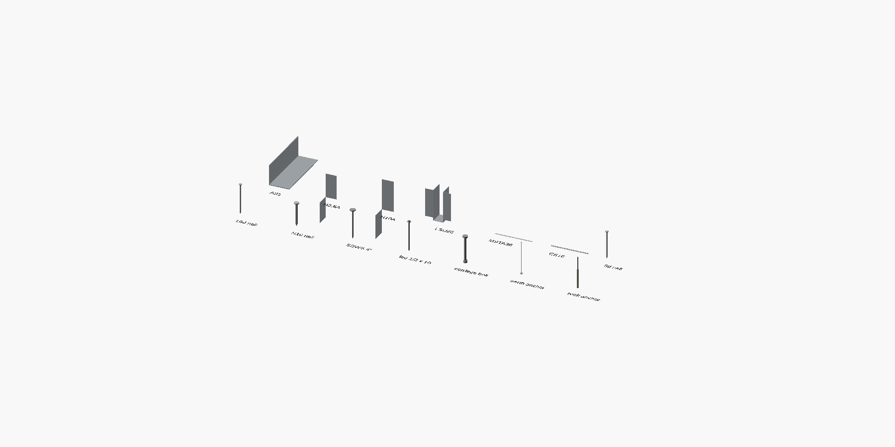

# FramingSCAD

An OpenSCAD-compatible library for light wood-frame buildings, built for [NeoSCAD](https://neoscad.org): lumber that reports itself, schematic framing
connectors and fasteners, and tools that turn a model into a cut list, a lumber order, a clash check
and construction drawings. It grew out of designing a 10' × 12' timber shed.



## Install

OpenSCAD and NeoSCAD have no package manager: `include <FramingSCAD/framing.scad>` is a path that
must resolve either next to your file or in a library search folder. Pick one of these.

**A. Per project, pinned (recommended).** Add the library as a git submodule and include it by
relative path. Every project records the exact commit it was built with.

```sh
git submodule add https://github.com/the-ned-workshop/FramingSCAD.git lib/FramingSCAD
```
```scad
include <lib/FramingSCAD/framing.scad>   // relative to the including file
```
Update later with `git -C lib/FramingSCAD pull` (or check out a tag) and commit the new pointer.

**B. Once per machine.** Clone into the user library folder, or into any folder on `OPENSCADPATH`,
and every model on the machine can `include <FramingSCAD/framing.scad>`. It's simpler, but unpinned:
every project sees whatever version is checked out.

```sh
# macOS (Linux: ~/.local/share/OpenSCAD/libraries; Windows: Documents\OpenSCAD\libraries)
git clone https://github.com/the-ned-workshop/FramingSCAD.git ~/Documents/OpenSCAD/libraries/FramingSCAD
```

`neoscad --info` (or OpenSCAD's Help → Library Info) lists the folders searched.

## NeoSCAD and OpenSCAD

| | Profiles are drawn as | Run with |
|---|---|---|
| **NeoSCAD** (recommended) | fully constrained sketches (`strict = true`): change a dimension and exactly the right thing moves; an under- or over-constrained profile is an error | `neoscad --enable sketch …` |
| **OpenSCAD** (2021.01 and later) | plain `polygon()` / `circle()` geometry, same shapes | `openscad -D FS_SKETCH=false …`, or set `FS_SKETCH = false;` after the `include` |

Everything else, including members, echo lines, tools and hardware, works the same in both. Plain
NeoSCAD without `--enable sketch` also needs `FS_SKETCH = false`. Neither program lets a file detect
the sketch extension, so the switch is explicit. Units are inches.

```scad
include <FramingSCAD/framing.scad>

stick("stud", "2x6", [0, 0, 7], [1.5, 5.5, 86]);          // an axis-aligned member
slab_xz("rafter", "2x6", 90, rafter_profile(3/12, -12, 0, 3.5, 58, 117.5, 5.67), 23.25);
xf(T([120, 0, 0])) along_y() stick("plate", "2x6", [0, 0, 0], [144, 5.5, 1.5]);   // placed members report world coordinates
translate([0, 30, 0]) h2_5a(count = true);               // hardware; count = true also orders it
```

## What's in it

| File | Contents |
|---|---|
| `lumber.scad` | `stick()`, `slab_xz()`, `slab_yz()` members; `rafter_profile()`; `dressed()` sizes; `sheet()`, `item()` order lines; `xf()`, `T()`, `along_y()`, `mirror_about_x()` placement transforms; `$noms`/`$tags` member filters |
| `sketches.scad` | `FS_SKETCH` switch; `profile(name, points)`: a closed polygon as a fully constrained sketch (or a polygon); `rect_profile()`, `strap_profile()` (strap with fastener holes), `pin_profile()` (revolved fastener half-profile) |
| `connectors.scad` | Simpson Strong-Tie-style schematic connectors: `a35()`, `h2_5a()`, `h10a()`, `lsu26()`, `face_hanger()`, `msta(l)`, `cs16(l)`, `post_cap()`, `angle_clip()`, `strap()` |
| `fasteners.scad` | `nail("6d"|"8d"|"10d"|"16d"|"N10")`, `sdws(len)`, `lag(d, len)`, `carriage_bolt(d, len)`, `earth_anchor(len)`, `rock_anchor(len, d)` |
| `framing.scad` | includes everything |
| `tools/cutlist.py` | ECHO → cut list and stock-length lumber order (first-fit-decreasing packing), sheet goods, hardware |
| `tools/collide.py` | finds members that overlap (not just touch), member type against member type |
| `examples/catalog.scad` | every component, laid out (renders `docs/catalog.png`) |

Connector and fastener shapes are close enough for details, clash checks and counts. They are **not**
catalogue drawings: check the manufacturer's current catalogue for exact dimensions, fastener schedules
and allowable loads.

## The ECHO contract

Members and parts echo machine-readable lines that the tools consume:

```
CUT|tag|nominal|length                          one per member      → cut list, lumber order
GEO|box|tag|nominal|[min x,y,z]|[max x,y,z]     axis-aligned member  → drawings (world coordinates)
GEO|poly|tag|nominal|[[x,y,z]…]|[dx,dy,dz]      profile + thickness  → drawings
SHEET|tag|kind|square feet                       sheet goods          → order
ITEM|tag|what|count                              bought items         → order
```

World coordinates work because placements go through `xf(matrix)`, which multiplies `$M`. Plain
`translate()`/`mirror()` still draw correctly, but the members inside them report local coordinates.

## Tools

```sh
NEOSCAD=/Applications/NeoSCAD.app/Contents/Helpers/neoscad
$NEOSCAD --enable sketch -o model.echo model.scad        # don't pass -q: it suppresses ECHO
# OpenSCAD: openscad -D FS_SKETCH=false -o model.echo model.scad
python3 tools/cutlist.py model.echo > order.md
python3 tools/collide.py model.scad "frame()" "roof()"   # module calls that build the framing
```

`collide.py` needs the model's top-level calls wrapped in `if (is_undef(model_only)) { … }` so it can
include the file and call the framing modules itself.

## Conventions

- Inches, z up. Tag members by what they are ("rafter", "loft joist"); the tag is the cut-list
  "member" column and the clash-check unit.
- Nominal strings start with a size from `DRESSED` and can carry a grade or treatment after a space:
  `"2x6"`, `"6x6 UC4B"`, `"4x6 DF#2"`, `"1-3/4x9-1/4 LVL"`.
- Hardware takes `count = true` to echo an `ITEM` line when it's placed.

## License

MIT — see [LICENSE](LICENSE).
